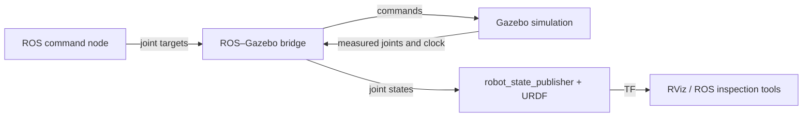

# Week 3 — Gazebo and Robot Kinematics Presentation Plan

## Slide 1 — From Frames to Moving Robots

- Recall the Week 2 transform chain; now joint angles change its transforms.
- Goal: describe a robot, predict its tool position, and command it in simulation.
- Spend 5 minutes on recap; reserve 25 minutes for the live demo and checkpoint.

## Slide 2 — What Is Gazebo?

- A robotics simulator with a world, robot models, a physics engine, and optional simulated sensors.
- It computes how the modeled system changes as simulation time advances.
- Identify the world and robot in the [labeled Gazebo view](demo/gazebo_overview.svg).

## Slide 3 — Why Do We Need Simulation?

- Develop before hardware is available; repeat experiments from a known setup.
- Try commands without risking the real robot; connect this to HW1.
- Models are approximations: geometry, physics, actuators, and sensors affect results. Validate later on hardware.

## Slide 4 — Gazebo, ROS 2, and RViz

- Gazebo simulates; ROS nodes communicate and compute; RViz visualizes ROS data.
- Show the command/measurement loop below, including the ROS–Gazebo bridge.
- Introduce play/pause, reset, and simulation versus wall time. Keep slides 2–4 to 5 minutes total.

## Slide 5 — Describe the Robot and Its World

- URDF: links, joints, parent/child origins, axes, limits, and inertias.
- Separate the link frame from its visual and collision geometry.
- SDF world: environment, physics settings, and simulation systems.
- Show one link and one joint from the demo rather than the entire XML file.

## Slide 6 — Our Two-Joint Arm

- `L1=0.6 m`, `L2=0.4 m`; both joints rotate about +z, with zero along +x.
- Define `q1`, relative angle `q2`, and the end-effector position in `base_link`.
- Mark the fixed base and the frame chain; use metres and radians.

## Slide 7 — Forward Kinematics

- `x = L1 cos(q1) + L2 cos(q1+q2)`.
- `y = L1 sin(q1) + L2 sin(q1+q2)`.
- Predict `(0, π/2) → (0.6, 0.4)`; explain why the second angle is a sum.

## Slide 8 — Inverse Kinematics

- Given `(x, y)`, solve for angles using the cosine rule and `atan2`.
- Show `q2 = ±acos((x²+y²−L1²−L2²)/(2L1L2))` and the matching q1 calculation.
- Target `(0.6, 0.4)` has two configurations; position is the same, tool orientation can differ.

## Slide 9 — When a Target Cannot Be Reached

- Reachable radii lie between 0.2 and 1.0 m; `(1.2, 0)` and `(0, 0)` are outside.
- Check joint limits as well as geometric reachability.
- Full extension/folding are singular; IK alone does not check obstacle-free motion.

## Slide 10 — Commands and Measured Motion

- Joint targets → bridge → Gazebo controllers; measured joint states → bridge → TF.
- `robot_state_publisher` computes frames from the model and measured angles.
- Compare the predicted position with measured-state FK and end-effector TF.
- Our idealized control is capped at 1 rad/s; actuator tuning comes later.

## Slide 11 — Predict, Then Run

- Identify the world, robot, camera controls, clock, and play/pause in Gazebo.
- Move individual joints; reach one target through both IK branches; reject an unreachable target.
- Keep slides 5–11 to 10 minutes total. The prepared demo carries the detailed explanation.

## Visuals Needed

- [Labeled Gazebo screenshot](demo/gazebo_overview.svg): world/robot, view navigation, play/pause, and clock.
- ROS–Gazebo–RViz architecture diagram from Slide 4.
- Two-link arm sketch with axes, lengths, relative angles, and both IK configurations.
- Workspace annulus and the expected terminal output from the demo README.

## Live Demo Transition

- Start from the saved Gazebo view and the zero configuration.
- Ask for the predicted tool position before executing the first command.
- Follow the [demo run sequence](demo/README.md); end by contrasting a requested target with a verified measured result.
