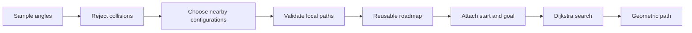

# Week 4 — Configuration Space and PRM Presentation Plan

## Slide 1 — A Reachable Goal Is Not Enough

- Week 3: IK gives a goal configuration. What happens along the motion to it?
- Show two safe endpoints with a blocked direct motion.
- Reserve 5 minutes for recap, 15 for concepts, and 25 for the demo and discussion.

## Slide 2 — Workspace Versus Configuration Space

- Workspace: the physical arm and obstacles. Configuration space: `(q1,q2)`.
- One point represents the entire arm, not only its tool (Introduction 15–20).
- Our bounded joints use a square without edge wrapping; unrestricted revolute joints form `S¹ × S¹`.

## Slide 3 — Which Configurations Are Free?

- Use FK to place both links, then check them against workspace obstacles.
- Include link thickness and padding; contact counts as collision.
- The plotted free-space background is a display approximation, not the planner's input.

## Slide 4 — Endpoints Are Not the Whole Path

- Interpolate between safe start and goal; show `(0,0)` colliding in between.
- Validate intermediate configurations, with explicit resolution and padding.
- Connect to the lecture's exact versus approximate local checking (PRM 17, 20).

## Slide 5 — PRM in Four Steps

- Sample configurations, keep free ones, connect valid local paths, search the graph.
- Vertices are configurations; edges are motions (PRM 4–5).
- Show the pipeline diagram below.

## Slide 6 — Sampling Free Configurations

- Uniform rejection sampling; accepted count differs from attempted count.
- Fixed seeds make a demonstration reproducible (PRM 7–8).
- A finite attempt budget avoids waiting indefinitely in a difficult scene.

## Slide 7 — Nearby Does Not Mean Connected

- Euclidean distance between joint-angle pairs; k=10 candidate neighbors.
- Each edge still needs a collision check; weight it by joint-space length.
- Straight interpolation respects hard joint limits (PRM 14, 20).

## Slide 8 — Construction Versus Query

- Build the roadmap once; attach the chosen endpoints for each query.
- Dijkstra returns the shortest route in this graph (PRM 21).
- That is not necessarily the globally shortest path, shortest tool motion, or fastest trajectory.

## Slide 9 — What Can Go Wrong?

- Uniform samples can miss narrow passages; sparse roadmaps can be disconnected.
- “No path found in this roadmap” does not establish impossibility.
- Probabilistic completeness is an asymptotic statement with assumptions; finite runs can fail (PRM 22–23).
- Leave advanced sampling, neighbor data structures, and PRM* proofs for preparation reading.

## Slide 10 — Predict, Build, Animate

- Preview both endpoints and the colliding midpoint before revealing the route.
- Reveal samples → edges → searched path; animate workspace and configuration space together.
- Compare 20 and 300 samples with the same seed; distinguish an observed improvement from a guarantee.
- Label animation as kinematic playback, with no dynamics or physical execution guarantee.

## Visuals Needed

- [Default overview](demo/overview.png) and [20-sample comparison](demo/overview_20.png).
- Synchronized arm/configuration-space panels, with direct edge and planned detour.
- Pipeline diagram from Slide 5 and a narrow-passage sketch for discussion.

## Live Demo Transition

- Open `robot.py` and `planner.py`; map their functions to the four steps.
- Run the [demo sequence](demo/README.md) and pause for predictions at each stage.
- Close with: what is a configuration, what makes an edge valid, and what does search failure mean?
