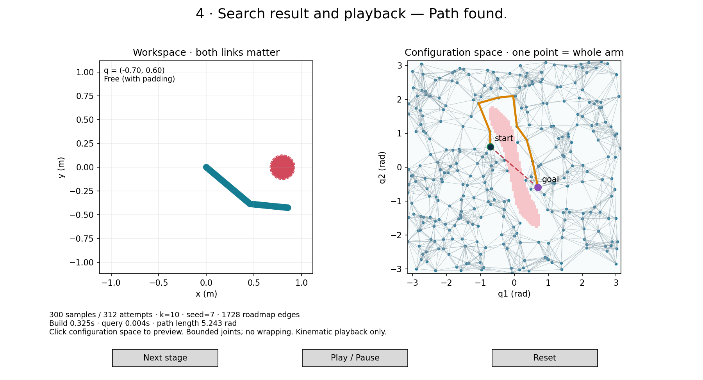
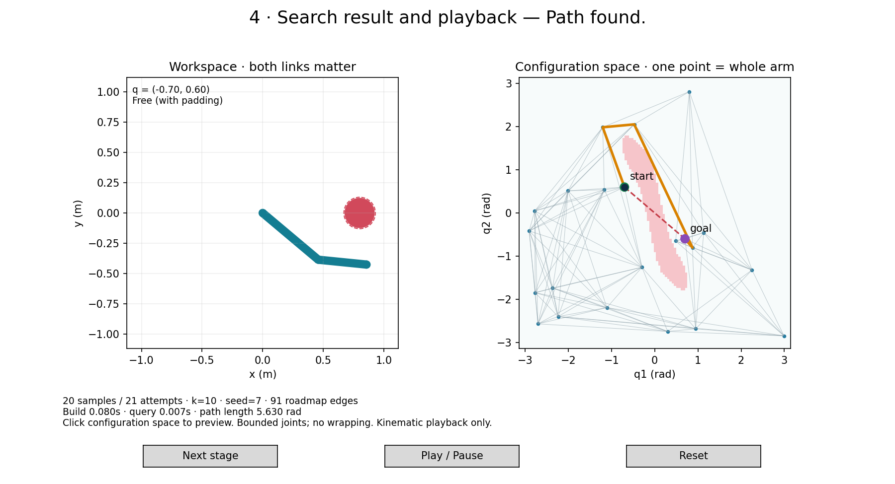

# Week 4 — PRM Demo

A Python-only demonstration: an arm in workspace beside its joint-angle
configuration space. No ROS or Gazebo process is needed.

## Run

Requires Python 3.10+, NumPy, and Matplotlib, already available on the TA machine.
Run from the repository root:

```bash
python3 week04_motion_planning/demo/demo.py
```

A desktop and a Matplotlib GUI backend (for example Qt or Tk) are needed for the
interactive window. For a headless machine:

```bash
python3 week04_motion_planning/demo/demo.py --export /tmp/prm_overview.png
```

This selects the Agg backend, writes the final-stage figure, and exits.

## Controls and Classroom Sequence

1. **Initial view:** start and goal are valid, but the dashed direct edge is blocked.
   Click `(0,0)` in configuration space to show the colliding straight arm.
2. **Next stage:** reveal accepted samples, then collision-checked connections,
   then the Dijkstra path. The calculation is prepared at startup; stages reveal
   the result so students can discuss each step.
3. **Play / Pause:** available at the final stage when a path exists. Both panels
   update together. Playback speed is 0.7 joint-space rad/s along the polyline.
4. **Click configuration space:** preview any configuration and its collision status.
   This pauses playback; pressing Play again starts the planned path from its start.
5. **Reset:** return to the first stage and starting pose, keeping the same roadmap.
   Replay after reaching the goal also starts at the beginning.

The teal arm is valid under the padded collision model; red indicates a violation.
The solid obstacle is physical geometry; its dashed outline adds safety padding.
The arm's physical thickness is shown in workspace coordinates. Pink regions in
configuration space are a display-only grid approximation; queries use geometry.



## Scene and Conventions

- Link lengths: 0.6 m and 0.4 m, matching Week 3; both rotate about +z.
- Start: `(-0.7,0.6)`; goal: `(0.7,-0.6)` radians.
- Circular obstacle center `(0.80,0)` m, radius 0.12 m.
- Links are capsules with radius 0.03 m; collision checks add 0.01 m padding.
- Both links are checked, including their endpoints. Contact is rejected.
- Self-collision is not modeled. The robot is a simplified planar geometry model.
- Joints have hard limits `[-π,π]`: interpolation does not wrap at plot boundaries.

The obstacle moved 5 cm outward from the original proposed center `(0.75,0)`.
With thickness and padding, that original scene blocked every q1=0 configuration,
so no bounded-joint route could connect these endpoints. The corrected scene keeps
the direct route blocked and permits a detour.

## Code Walkthrough

| Module / function | Lecture concept |
| --- | --- |
| `robot.py`: `forward_points(q)` | Map configuration into workspace geometry |
| `configuration_free(q)` | Test both link capsules against the padded obstacle |
| `interpolate`, `edge_free(a,b)` | Local motion and intermediate collision checks |
| `planner.py`: `build_roadmap(samples, neighbors, seed)` | Uniform rejection sampling and k-nearest connections |
| `query_roadmap(roadmap,start,goal)` | Attach endpoints to a copy, then search |
| `shortest_path` | Dijkstra with joint-space edge lengths |
| `demo.py` | Reveal stages, preview poses, animate, and export |

The defaults are 300 **accepted** samples, k=10 neighbors, seed 7. Rejection sampling
allows up to 100 attempts per requested sample in total. The Python API accepts
`max_attempts` to override that bound and reports exhaustion explicitly.

An undirected connection is considered if either endpoint selects the other among
its k nearest neighbors, and retained only after a valid edge check. Endpoints
attach to their k nearest roadmap vertices; a valid direct query edge is also
considered. The reusable construction graph remains unchanged by each query.

`query_roadmap` returns a `QueryResult` containing `path`, `length`, `message`, and
the query graph. A disconnected query has an empty path, `length=None`, and
**No path found in this roadmap.** Invalid endpoints/settings raise `ValueError`;
exhausted sampling raises `RuntimeError`. A free start equal to goal returns a
one-configuration, zero-length path.

## Local Checking and Playback

Every edge is checked at endpoints and interpolated configurations with maximum
joint increments of 0.01 rad. Playback follows the same validated polyline and
uses these interpolation samples as its basis. This is sampled local validation
with conservative geometry and padding, not a general continuous collision library.

The 0.01 m padding gives additional clearance; changing lengths, collision models,
resolution, or padding requires revalidation. The demo is not a safety guarantee
for a physical robot. Playback adds illustrative timing but has no actuator,
acceleration, or dynamic model.

## Reproducible Comparison

```bash
python3 week04_motion_planning/demo/demo.py --compare
python3 week04_motion_planning/demo/demo.py --samples 20 --neighbors 10 --seed 7
python3 week04_motion_planning/demo/demo.py --samples 300 --neighbors 10 --seed 7
```

The 20 accepted configurations are a prefix of the 300-sample sequence. Changing
sample count can change nearest-neighbor choices, so edges are not necessarily
nested. The default observations are:

| Accepted samples | Attempts | Roadmap edges | Path length (rad) |
| ---: | ---: | ---: | ---: |
| 20 | 21 | 91 | 5.630 |
| 300 | 312 | 1728 | 5.243 |

Both find paths in this scene. The edge count excludes query attachments; the
figure also shows those attachments. Build/query times vary by machine and run.
More samples do not guarantee a shorter result for every seed and fixed-k graph.
The shortest roadmap path is not a global continuous-space optimum.



A tiny graph such as `--samples 1 --neighbors 1` can demonstrate finite-roadmap
failure. A failed search does not establish that a physical path is impossible.
Uniform sampling can miss narrow passages; no completeness theorem is asserted
for this exact fixed-k classroom implementation.

## Tests and Fallback

```bash
python3 -m unittest discover -s week04_motion_planning/demo -p 'test_*.py'
```

Tests include FK/model dimensions, both-link collision and contact, invalid
inputs, blocked direct motion, default-route discovery, denser independent path
checks, deterministic sampling, bounded failure, graph search, query immutability,
and stage/preview/playback/reset callbacks.

- If a GUI backend is unavailable, use `--export` or the two saved images.
- If launched from a Snap terminal with GTK library errors, use a normal system
  terminal or remove the inherited GTK/GIO paths as in Week 3.
- If Play does nothing, advance to the final stage and confirm the query succeeded.
- Use the same seed and k for sample-count comparisons; timing need not match.
- Do not infer exact boundaries from the display grid. The collision function is
  the source of truth for the planner.

Rehearse 5 minutes code, 12 minutes stages/animation, and 8 minutes comparison and
checkpoint. The [teaching notes](../TEACHING_NOTES.md) include the full schedule.

## Validation on the TA Machine

- Eight tests passed, including an independent denser replay of the final path.
- The default direct edge is rejected; both fixed-seed comparison roadmaps find paths.
- The Qt GUI rendered successfully and its event-loop timer advanced playback.
- Stage changes, pose preview, play/pause, reset, and arrival at the goal were tested.
- Headless exports, Markdown links, ten slides, and the 45-minute schedule were checked.

## Sources

The supplied `MotionPlaningIntroPRM.pdf`, credited to Oren Salzman: Introduction
15–20; PRM 4–8, 14, 17, 20–23 (printed slide numbers within each section).
The PDF is supplied separately and is not copied into this repository.
See [TA_plan.md](../../TA_plan.md), Session 4 and HW2.
