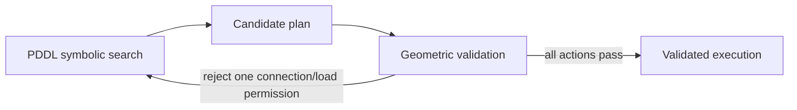

# Week 5 — Classical Planning and TAMP Presentation Plan

## Slide 1 — From “How to Move” to “What to Do”

- Week 4: find a motion between configurations. Week 5: choose actions and their order.
- Goal: deliver a package through an environment with a narrow shortcut and a wider detour.
- Spend 5 minutes on recap, 20 minutes on concepts, 15 on the demo, and 5 on the checkpoint.

## Slide 2 — A State Is a Set of Facts

- Initial facts: `(robot-at delivery)`, `(package-at parcel pickup)`, `(hand-empty)`.
- Goal: `(package-at parcel delivery)`.
- Absent facts are false in this classical model; the state and outcomes are assumed known.

## Slide 3 — Actions Have Preconditions and Effects

- `pick(parcel,pickup)` needs the robot, package, and empty hand at the right place.
- Add holding; delete package-at and hand-empty.
- Facts not changed by an action remain true. Predict the state after pickup.

## Slide 4 — PDDL: Domain Versus Problem

- Domain: types, predicates, action schemas.
- Problem: objects, initial state, goal.
- Show the two short files side by side; explain parameter grounding with one example.

## Slide 5 — Read the Delivery Model

- Four actions: move-empty, move-loaded, pick, place.
- Read a move action's location, load, and permitted-connection preconditions.
- Geometric coordinates are supplied separately; optimistic permission is not a collision certificate.

## Slide 6 — Search Symbolic States

- Pyperplan parses PDDL and applies BFS to grounded actions.
- First candidate: empty shortcut → pick → loaded shortcut → place.
- BFS minimizes action count here, not travel distance. Slides 2–6 take about 12 minutes.

## Slide 7 — A Valid Symbolic Plan Can Fail Geometrically

- A permission may omit a constraint such as the carried package's footprint.
- Check actual motion and footprint changes before execution.
- Explain that candidate validation uses a temporary hypothetical state.

## Slide 8 — The Task-and-Motion Loop

- Preserve the original initial state while refining the model.
- This demo searches a finite set of designated motions; general TAMP has more continuous choices.

## Slide 9 — Empty Fits; Loaded Does Not

- Gap width: 0.40 m. Empty diameter: 0.24 m. Loaded diameter: 0.50 m.
- Reject only the loaded pickup → delivery shortcut; the empty crossing still fits.
- The revised plan carries the parcel along the upper route. Slides 7–9 take about 8 minutes.

## Slide 10 — Predict the Failure, Then Replan

- Ask which action fails and which permission should change.
- Reveal the rejection, inspect the revised six-action plan, and animate delivery.
- End by distinguishing symbolic applicability, geometric validity, and actual execution.

## Visuals Needed

- [Rejected candidate](demo/rejected.png), [validated route](demo/overview.png), and [delivery complete](demo/delivered.png).
- Domain/problem snippets, before/after pickup facts, and the loop diagram above.
- Empty/loaded footprint comparison at the narrow passage.

## Live Demo Transition

- Open the PDDL files before opening the visualization.
- Follow the [demo runbook](demo/README.md): initial → candidate → rejection → revision → execution.
- Keep the hypothetical-state label visible during rejection; do not describe that preview as executed motion.
