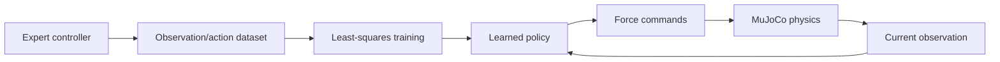

# Week 7 — Imitation Learning in MuJoCo Presentation Plan

A practical 45-minute session with 18 minutes reserved for the demo. Source numbers below refer to printed slides in the professor's `Class9-ImitationLearning.pdf`.

## Slide 1 — From Computing a Policy to Learning One

- Recall Week 6's observation/state → action policy.
- Now expert examples provide training labels instead of solving Bellman equations.
- Prompt: “What data would let us imitate a controller?” Source: 3–4.

## Slide 2 — What MuJoCo Does

- Model geometry/joints/actuators; maintain state; simulate forces and motion; render the scene.
- Python policy → force commands → physics steps → new observation.
- MuJoCo itself does not learn our policy.

## Slide 3 — Our Reaching Task

- Show two-axis robot and orange target; identify continuous position and velocity.
- Observation: `[error_x, error_y, velocity_x, velocity_y]`; action: `[force_x, force_y]`.
- Success requires small distance AND speed throughout the final 0.5 s.

## Slide 4 — Who Is the Expert?

- Scripted feedback: `force = 4 × error − 3 × velocity`, clipped to ±10 N.
- Position pulls; velocity brakes. The expert need not be human.
- The learner will receive examples, not these coefficients.

## Slide 5 — Demonstrations Become Training Pairs

- Record current observation before applying its expert action.
- Example `[0.3, −0.2, 0.1, 0] → [0.9, −0.8]` N; ask students to calculate it.
- 100 trajectories × 250 control decisions = 25,000 labeled rows. Source: 4, 8.

## Slide 6 — Behavior Cloning Minimizes Prediction Error

- Fit `a_hat = W o + b` using mean squared error between predicted/expert forces.
- Use NumPy least squares; BC does not require a neural network.
- Distinguish action-label loss from a reward function. Source: 8–9.

## Slide 7 — Training Versus Evaluation

- Split by complete trajectories: 80 train / 20 validation.
- Evaluate expert, learner, and zero-action baseline on the same 20 fresh cases.
- Held-out action MSE and rollout success answer different questions.

## Slide 8 — Follow the Whole Pipeline

- Expert supplies labels during collection; learner runs independently during evaluation.
- No stored action replay: each action responds to the current observation.

## Slide 9 — When Imitation Drifts

- A mistake can change visited states; later inputs may differ from training data.
- DAgger: visit states with learner → ask expert → aggregate → retrain.
- This simple linear task should imitate well; do not manufacture a failure.
- Name IRL (infer rewards) and GAIL (match distributions) as further approaches. Sources: 10–15, 33.

## Slide 10 — Predict, Then Run

- Watch expert, collect, fit, then watch learner on the same test start.
- Predict learned weights and compare overlapping trajectories.
- Checkpoint: who provides dynamics, labels, and learned actions?
- Connect to HW4's simulation/evaluation workflow; later lessons introduce RL.

## Visuals Needed

- Original pipeline diagram above and one labeled dataset row.
- MuJoCo scene showing robot, target, and camera view during the live tour.
- [Saved comparison](demo/comparison.png): expert/learner paths, distance over time, and 20-episode success counts.
- Show trajectory overlap explicitly; it is expected for this representable linear expert.

## Live Demo Transition

“First watch the expert. Then we will save what it sees and does, fit a new policy, and let that policy control the simulator.” Follow the [runbook](demo/README.md); reserve setup/install work for preparation.
