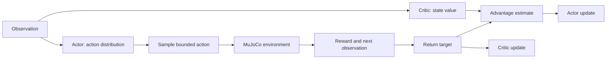

# Week 9 — Policy Gradients and Actor–Critic Presentation Plan

A short explanation and 17-minute demonstration. No actual slides are created.

## Slide 1 — From Q-Values to a Policy Network

- Week 8: state → Q-values → action selection.
- Today: state → actor network → continuous action.
- A critic still learns values to help train the actor.

## Slide 2 — Why a Q-Table Becomes Impractical

- Continuous observations and actions require discretization for a table.
- Finer resolution increases table size; neural policies provide a different representation.
- Value-based function approximation also exists; avoid claiming all value-based methods fail here.

## Slide 3 — Balance a Pole by Moving a Cart

- Four observations: cart position, pole angle, and their velocities.
- One continuous control command; healthy reward +1, failure reward 0.
- Failure: angle magnitude >0.2 rad or nonfinite state; time limit 1,000 steps.

## Slide 4 — A Stochastic Policy Produces a Distribution

- Actor outputs Gaussian mean and learns its spread; sample during training.
- Tanh bounds the applied command. Evaluation uses the transformed mean.
- Contrast with epsilon-greedy; no epsilon slider in this demo.

## Slide 5 — Policy-Gradient Intuition

- Increase the probability of sampled actions with positive estimated advantage.
- Negative advantage discourages an action relative to current behavior.
- No expert action labels: reward feedback drives the update.

## Slide 6 — The Critic Estimates Expected Return

- V(s) is one scalar prediction, not a recommended action.
- Compare predicted discounted value with observed cumulative reward; they are different quantities.

## Slide 7 — Advantage Connects Critic and Actor

- Reveal `target = 1 + .99 × 6 = 6.94`.
- Then `advantage = 6.94 − 5 = 1.94`.
- Ask what the sign implies; distinguish estimated improvement from a guarantee.

## Slide 8 — Read One Actor–Critic Update

- Collect fresh rollouts → build bootstrapped targets → compute advantage → update both networks.
- Actor loss: `−log pi × detached advantage`; critic loss: squared target error.
- Five-step returns extend the one-step example. Stop returns at reset boundaries.
- No replay, PPO objective, or repeated optimization over old batches.

## Slide 9 — Compare Initial and Trained Behavior

- Same test start, same camera, different saved policy.
- Inspect pole angle, steps, return, and critic prediction.
- Show all three training seeds; checkpoint selection uses separate validation starts.

## Slide 10 — Where PPO and SAC Fit

- PPO: controls policy changes during optimization; SAC: entropy-based actor–critic with replay.
- Both are overview only. Today's code implements synchronous advantage actor–critic.
- Checkpoint: which component acts, which evaluates, and what supplies supervision?
- Connect to HW4's training and multi-seed reporting.

## Visuals Needed

- [Validation and held-out comparison](demo/classroom/comparison.png).
- [Stochastic training curves](demo/classroom/training.png).
- Live MuJoCo frames with controller name and state/value readout.

## Live Demo Transition

“Watch the initial policy first. Then we will inspect the actor–critic update and switch to the policy trained from rewards.” Use the [demo runbook](demo/README.md).

Preparation sources: [policy-gradient intuition](https://spinningup.openai.com/en/latest/spinningup/rl_intro3.html), [A2C reference](https://stable-baselines3.readthedocs.io/en/master/_modules/stable_baselines3/a2c/a2c.html), [task documentation](https://gymnasium.farama.org/environments/mujoco/inverted_pendulum/). No professor slides were supplied for this week.
