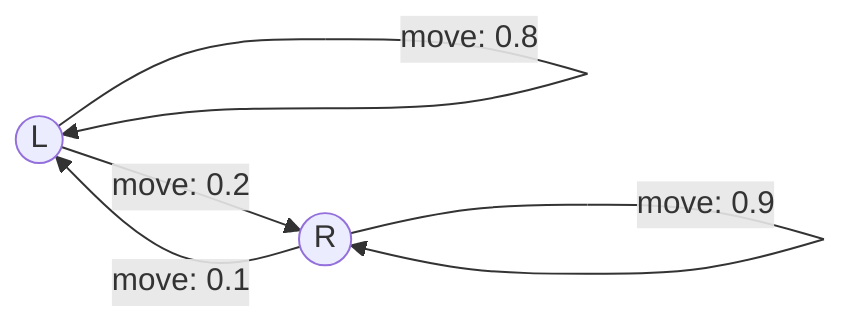

# Week 10 — POMDP Foundations and Belief Updates Presentation Plan

Theoretical 45-minute session: presentation, board work, and short in-class exercises. References below use printed slide numbers in **Class18-POMDPs.pdf** (whose title page says “Class 17”). Numerical examples are TA-created using the lecture's notation.

## Slide 1 — What Changes from an MDP?

- MDP transitions may be random, but the resulting state is observed.
- POMDP: the true state is not directly available; sensors provide partial evidence.
- Prompt: “Does stochastic motion alone make a model a POMDP?” Answer: no.
- Lecture: 2.

## Slide 2 — State versus Observation

- Separate physical robot location from its sensor reading.
- Refer to the professor's wall-sensor example: some moves distinguish the possible locations better than others.
- Actions can gather information. Lecture: 3–5.

## Slide 3 — The POMDP Model

- Introduce `S, A, Tr, R, Ω, O`; define planning horizon/discount separately.
- Fix timing: old state s → action a → resulting state s′ → observation o.
- Use `O(s′,a,o)` consistently, matching the update on lecture slide 10.
- Lecture: 3, 10.

## Slide 4 — Why History Matters

- The latest sensor reading alone may not explain our current knowledge.
- Past actions and observations affect which states are plausible.
- A history-dependent policy is cumbersome; belief summarizes relevant history under the model.
- Lecture: 6–9.

## Slide 5 — Belief States

- A probability distribution: nonnegative entries summing to one.
- Introduce Example A: states L/R, prior `(0.6,0.4)`.
- Ask why a belief differs from simply choosing the most likely location.
- Lecture: 8–9.

## Slide 6 — Predict after an Action

- Display move transitions: L→L .8, L→R .2, R→L .1, R→R .9.
- Reveal `b̄(s′)=Σ_s Tr(s,a,s′)b(s)` before the arithmetic.
- Calculate `b̄(L)=.8×.6+.1×.4=.52`; `b̄(R)=.48`.
- Rows mean old states, columns mean resulting states. Lecture: 10.

## Slide 7 — Correct after an Observation

- Sensor table: L gives red .9 / blue .1; R gives red .2 / blue .8.
- Reveal likelihood × prediction, then sum weights, then divide.
- `P(o|b,a)=Σ_s′ O(s′,a,o)b̄(s′)` is the normalizer.
- Ask why a likelihood is not a posterior. Lecture: 10.

## Slide 8 — Calculate the Posterior

- Red weights `.468, .096`; normalizer `.564`; posterior `(.8298,.1702)`.
- Give students the blue alternative from the **same** prediction.
- Reveal after the exercise: weights `.052,.384`; normalizer `.436`; posterior `(.1193,.8807)`.
- A zero normalizer makes the conditional posterior undefined under the model.

## Slide 9 — A Policy Acts on Beliefs

- Different uncertainty can justify different actions, even with the same most likely state.
- Explain expected reward `R(b,a)=Σ_s b(s)R(s,a)`.
- Bellman intuition: immediate reward plus future values averaged over possible observations and updated beliefs.
- Mention remaining horizon for finite-horizon policies. Lecture: 11–12.

## Slide 10 — When Information Is Worth Its Cost

- **New Example B: prior (.5,.5), no movement before sensing.**
- Correct commitment +10, incorrect −10, task ends; sense costs 1, leaves state unchanged, then one commitment. No discounting.
- Immediate expected reward 0. Red probability .55 → choose L; blue .45 → choose R.
- Reveal `−1 + .55×(70/11) + .45×(70/9) = 6`.
- Prompt: “What if sensing costs 8?” Answer: immediate commitment is better.
- Lecture motivation: 5, 11–12.

## Slide 11 — Policy Trees and Alpha-Vectors

- Draw sense at root, red/blue branches, commit L/R at leaves.
- For **immediate commitment only**: `α_L=(10,−10)`, `α_R=(−10,10)`.
- With `p=b(L)`, plot `20p−10` and `10−20p`; the upper envelope chooses the better commitment.
- One vector stores a fixed policy's value in each hidden state. Do not derive multi-step backups.
- Lecture: 13–19.

## Slide 12 — Common Mistakes and Checkpoint

- Reconstruct predict → likelihood weighting → normalize.
- Check state versus observation, transition direction, and initial belief for each example.
- Ask why information can be worth paying for and why it is not always worth it.
- Week 11 will cover the actual homework solution after the homework exists.

## Visuals Needed

Original transition diagram for Example A:

- Use the transition, sensor, and calculation tables in the [teaching notes](TEACHING_NOTES.md).
- Use the original sensing policy tree in those notes, keeping Example B's uniform prior visible.
- [Commitment value plot](visuals/commitment_values.svg): two action lines and their upper envelope, excluding sensing.
- Refer to the professor's original wall-sensor illustration on printed slide 5 without copying the PDF into the repository.

## Live Demo Transition

“Keep the two possible locations on the board. First predict where the robot could be after moving; only then use the sensor reading.” Open the [board-work guide](demo/README.md); no software demonstration is required.
