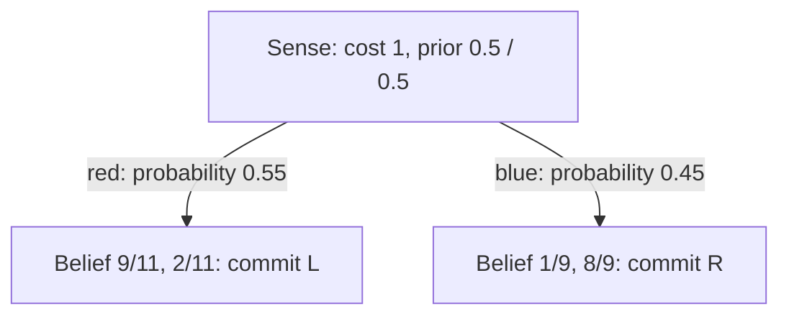

# Week 10 — POMDP Foundations and Belief Updates

## Goal

Students should distinguish hidden state from observation, calculate a belief update, and explain why gathering information can improve a decision.

**Uncertain state → action → observation → updated belief → decision.**

This is a theoretical session: presentation, board calculations, and short in-class exercises. No live code.

## Context / Recap

An MDP may have uncertain transitions while still revealing the resulting state. A POMDP additionally makes that state only partially observable. A sensor reading is evidence about the state, not necessarily the state itself.

Follow [TA_plan.md](../TA_plan.md), Session 10. The professor's source is **Class18-POMDPs.pdf**, originally `/home/gilad/Downloads/Class18-POMDPs.pdf`. Its title page says **Class 17**. References below use the filename and **printed slide numbers**. The PDF is not copied into this repository; its classroom prompts are source material.

| Topic | Printed slides |
|---|---|
| Partial observability and POMDP model | 2–5 |
| History and beliefs | 6–9 |
| Bayesian belief update | 10 |
| Belief-state MDP and planning | 11–12 |
| Policy trees | 13–14 |
| Value-function shape and alpha-vectors | 15–19 |

Use slide 5's wall-sensor example qualitatively: some moves produce observations that distinguish the possible locations, while other moves leave them ambiguous. Do not infer numerical sensor probabilities from that illustration.

## Core Explanation

### Model and observation convention

Use the lecture's tuple `⟨S, A, Tr, R, Ω, O⟩`: states, actions, transition probabilities, rewards, observations, and observation probabilities. Specify horizon and discount separately when describing a planning objective.

- `Tr(s,a,s′)` is the probability of resulting state s′ given old state s and action a.
- `O(s′,a,o)` is the probability of observation o given the **resulting state** s′ and action a.
- Action occurs first, state transitions, then the sensor produces an observation.
- Slide 3 mentions alternative observation conventions. Use the post-action convention from slide 10 throughout this session.
- A belief `b(s)` is a nonnegative distribution summing to one. Given the assumed model, it summarizes the action/observation history needed for future decisions.

### Example A: move, then observe

**TA-created numbers using the lecture's notation.** Two possible robot locations are L and R. Start this question with `b=(0.6,0.4)` in (L,R) order.

Transition model for action **move** (rows: old state; columns: resulting state):

| From / to | L | R |
|---|---:|---:|
| L | 0.8 | 0.2 |
| R | 0.1 | 0.9 |

Sensor model after movement:

| Resulting state | Red | Blue |
|---|---:|---:|
| L | 0.9 | 0.1 |
| R | 0.2 | 0.8 |

Each row of each model sums to one. The robot does not know which state actually occurs; it updates a distribution.

**1. Predict after the action**

```text
b̄(s′) = Σ_s Tr(s,a,s′) b(s)
b̄(L) = 0.8 × 0.6 + 0.1 × 0.4 = 0.52
b̄(R) = 0.2 × 0.6 + 0.9 × 0.4 = 0.48
```

**2. Weight by the observation likelihood**

```text
w(s′) = O(s′,a,o) b̄(s′)
P(o | b,a) = Σ_s′ w(s′)
```

**3. Normalize**

```text
bᵃᵒ(s′) = w(s′) / P(o | b,a)
```

Board answer for **red**, followed by the student exercise for **blue**:

| Quantity | L | R | Sum |
|---|---:|---:|---:|
| Predicted belief (both alternatives) | 0.52 | 0.48 | 1 |
| Red likelihood | 0.9 | 0.2 | Not a belief |
| Red weights | 0.468 | 0.096 | 0.564 |
| Posterior after red | 0.829787… | 0.170213… | 1 |
| Blue likelihood | 0.1 | 0.8 | Not a belief |
| Blue weights | 0.052 | 0.384 | 0.436 |
| Posterior after blue | 0.119266… | 0.880734… | 1 |

Red and blue are **alternative observations from the same predicted belief**, not consecutive updates. The normalizer is the probability of that observation under the current belief/action. Likelihoods across states need not sum to one. If the normalizer is zero, the observation is impossible under the model and this conditional posterior is undefined; do not divide by zero or invent a uniform posterior.

### Example B: sense before committing

**Separate question: reset the belief to `(0.5,0.5)`.** There is no move action before the sensor reading here. Sense leaves the state unchanged (identity transition) and uses the same red/blue sensor probabilities.

- Commit L: +10 in L, −10 in R, then the task ends.
- Commit R: −10 in L, +10 in R, then the task ends.
- Sense: reward −1, observe red/blue, then make one commitment.
- Compare these finite alternatives with **no discounting** (gamma=1). This is not an undiscounted infinite-horizon claim.

Immediate commitment has value `0.5 × 10 + 0.5 × (−10) = 0` for either choice.

| Sense outcome | Probability | Posterior (L,R) | Best commitment | Conditional commitment value |
|---|---:|---|---|---:|
| Red | 0.55 | (9/11, 2/11) | L | 70/11 ≈ 6.3636 |
| Blue | 0.45 | (1/9, 8/9) | R | 70/9 ≈ 7.7778 |

```text
Value(sense then commit)
= −1 + 0.55 × (70/11) + 0.45 × (70/9)
= −1 + 3.5 + 3.5
= 6
```

Cross-check: the policy commits correctly with probability `0.5×0.9 + 0.5×0.8 = 0.85`. Expected commitment reward is `0.85×10 − 0.15×10 = 7`; subtract sensing cost 1 to get 6.

Information has value because it can change the later decision. With sensing cost c, this example's value is `7−c`: sensing beats immediate commitment only when c<7 (ties at 7). At other priors, sensing may not alter the best decision and may not be worth its cost.

Original policy tree:



### Planning over beliefs

A policy chooses an action from a belief (and remaining horizon for finite-horizon planning). Expected immediate reward is `R(b,a)=Σ_s b(s)R(s,a)`.

Interpret the lecture's Bellman equation rather than computing another example:

```text
V(b) = max_a [R(b,a) + gamma Σ_o P(o | b,a) V(bᵃᵒ)]
```

Choose an action, average over possible observations, and value the future updated beliefs. Even two hidden states admit infinitely many beliefs. A finite-horizon version also tracks remaining steps.

### Brief alpha-vector bridge: immediate commitment only

Return to the one-step commitment choices in Example B; sensing is excluded from this particular plot.

```text
α_L = (10, −10); α_R = (−10, 10)
p = b(L), b(R) = 1−p
V_L(p) = 20p−10; V_R(p) = 10−20p
V_commit(b) = max(b·α_L, b·α_R)
```

At p=.5 the two commitment values tie at zero. Each vector stores the values of one fixed decision at the possible hidden states. More generally, a fixed contingent policy tree has such a state-conditioned value vector. The upper envelope selects the best available policy for each belief; it is not averaging the policies.

Use the [original two-line plot](visuals/commitment_values.svg). Its value at the uniform belief is 0, while the two-action sensing strategy gives 6: these are different sets of allowed decisions/horizons. Leave multi-step alpha-vector construction, pruning, exact value iteration, point-based planning, and POMCP for preparation reading (lecture 17–39), not the live lesson.

## Live Demo

This section describes board work; there is no software demonstration.

**Belief update and exercise — 15 minutes:**

1. 3 min: introduce Example A, its prior, and row/column conventions.
2. 4 min: predict `(0.52,0.48)` and weight the red observation.
3. 3 min: normalize and interpret the posterior; ask why it is not `(0.9,0.2)`.
4. 3 min: students independently calculate the blue alternative.
5. 2 min: reveal `(0.1193,0.8807)` and discuss normalization/direction mistakes.

**Value of information — 10 minutes:** explicitly erase/reset the prior to `(0.5,0.5)`. Compare immediate commitment with sense-then-commit, draw observation branches, and verify expected value 6. Ask whether sensing remains worthwhile if it costs 8; answer: no, the strategy gives −1 versus immediate value 0.

**Policy representation — 5 minutes:** connect the tree to two immediate-commitment alpha-vectors and their upper envelope. No vector-backup derivation.

Closing answers: the observation is evidence; belief is a distribution; prediction uses transitions; correction uses likelihoods; normalization divides by observation probability; actions may be useful for information as well as immediate reward.

## Timing

| Part | Minutes |
|---|---:|
| Recap: state uncertainty versus uncertain transitions | 5 |
| POMDP components, observations, and beliefs | 7 |
| Worked belief update and student exercise | 15 |
| Planning and the value of information | 10 |
| Policy trees and alpha-vector intuition | 5 |
| Checkpoint and recap | 3 |
| **Total** | **45** |

## Common Questions / Problems

- **Does an MDP require deterministic motion?** No. Partial observability concerns knowledge of the resulting state, not just stochastic dynamics.
- **Is O(L,move,red) the posterior probability of L?** No; it is P(red | resulting state L, move). Bayes' rule combines it with the predicted belief.
- **Which way does the transition table go?** Rows are old states, columns are new states; sum over old states for each destination.
- **Can I skip prediction?** Only if the relevant transition is identity, as for sense in Example B. It is not identity for move in Example A.
- **Why do likelihoods across states not sum to one?** Their conditioning states differ. Sensor probabilities sum across observations for each fixed state/action.
- **Does blue follow the red posterior?** No. Those are two alternatives from the same prediction.
- **Why did the prior become .5/.5?** Example B is a new question, not the next step of Example A.
- **Is the most likely state enough?** Collapsing belief loses uncertainty relevant to expected rewards and sensing decisions.
- **Is the alpha-vector graph the full sensing problem?** No. It shows the two immediate commitments only.

## Homework Connection

The homework has not been created. Prepare students to read a POMDP model, track observation timing, update beliefs, and reason about contingent choices. These are relevant to the POMDP topics listed for HW5 without defining any new homework questions. Reserve the actual homework-solution walkthrough for Week 11 when the assignment exists.

## Preparation Checklist

- [ ] Review Class18-POMDPs.pdf printed slides 2–19 and the title-page numbering discrepancy.
- [ ] Review the wall-sensor motivation on slide 5; keep the numerical examples labeled TA-created.
- [ ] Reproduce all prediction, weighting, normalization, and sensing calculations.
- [ ] Prepare a board layout with separate prior/prediction/likelihood/weights/posterior columns.
- [ ] Hide the blue exercise answer until students have attempted it.
- [ ] Explicitly reset the prior before Example B and state its finite horizon.
- [ ] Prepare the policy tree and commitment-value plot.
- [ ] Rehearse the 45-minute sequence; omit advanced planning algorithms.
