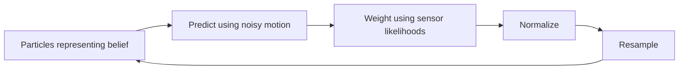

# Week 12 — Particle Filters and SLAM Presentation Plan

Theory supported by a staged visualization; 45 minutes, no code walkthrough. Numerical examples are TA-created. Sources and full answers are in the [teaching notes](TEACHING_NOTES.md).

## Slide 1 — Where Is the Robot?

- Contrast a true position with a noisy position estimate and a cloud of possibilities.
- Prompt: does one coordinate tell us how certain we are?

## Slide 2 — From Week 10 to Localization

- Recall belief prediction and observation correction.
- Continuous `(x,y)` replaces two discrete locations; heading is fixed in this illustration.

## Slide 3 — A Belief Made of Particles

- Each dot is one hypothetical state; weights describe relative plausibility.
- A particle cloud can represent multiple possibilities. Its mean is only a summary.

## Slide 4 — Predict after Moving

- Reveal `x_i ← x_i + command + sampled motion noise`.
- Prompt: should every hypothesis move by exactly the same amount? No.

## Slide 5 — Compare Predicted and Actual Measurements

- Three known, identified landmarks provide noisy ranges.
- Each hypothetical position predicts ranges; compare them with the observed values.
- Ground truth is shown for teaching and is hidden from the filter.

## Slide 6 — Weight and Normalize

- Reveal prior weight × likelihood, then divide by the total.
- Work the three-particle example: equal priors and likelihoods `.6,.3,.1` give weights `.6,.3,.1`.
- Prompt: did the particle positions change? No.

## Slide 7 — Resample

- Draw copies according to weights, then assign uniform weights.
- Expected counts out of ten: 6,3,1. Explain the systematic-resampling special case in the notes.
- Resampling adds no measurement; duplicates can overlap and diversity can be lost.

## Slide 8 — Predict What the Cloud Will Do

- Open the visualization; pause before prediction, weighting, and resampling.
- Ask what will move and what will change size/color at each stage.
- Repeat with noisier observations; keep code hidden.

## Slide 9 — Uncertainty and Failure

- Less informative sensors usually constrain belief less strongly.
- Ambiguity, model mismatch, and particle depletion can cause failures.
- A tight cloud is not proof of correctness; no promise of improvement at every update.

## Slide 10 — Localization versus Mapping versus SLAM

- Localization: known map → estimate robot state.
- Mapping: known poses → estimate map.
- SLAM: jointly estimate trajectory and map; the visualization covers localization.

## Slide 11 — Why SLAM Is Coupled

- Use the original pose/map diagram from the notes.
- Wrong poses misplace observations; wrong maps mislead localization.
- Loop closure uses recognized revisits as constraints; introduce uncertain occupancy cells without an algorithm derivation.

## Slide 12 — Checkpoint and HW6

- Reconstruct the filtering cycle and identify the step using sensor evidence.
- Ask what SLAM estimates beyond localization: the map alongside the trajectory.
- Connect to HW6's motion/measurement updates and occupancy-grid mapping.

## Visuals Needed

- Original particle clouds before prediction, after prediction, after weighting, and after resampling: [fallback figures](demo/figures/initial.png).
- Worked weight table and localization/mapping/SLAM comparison table from the notes.
- Original data flow:

- Pose/map dependency diagram from the notes; label this conceptual SLAM explanation separately from the known-map visualization.

## Live Demo Transition

“Each dot is a possible position. Before we move or read the sensor, predict what should change.” Open the [visualization](demo/README.md) at slide 8; return to slides 9–12 afterward.
