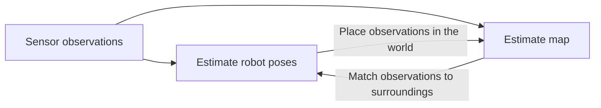

# Week 12 — Particle Filters and an Introduction to SLAM

## Goal

Students should explain how particles approximate a belief, distinguish prediction, weighting, and resampling, and distinguish localization from mapping and SLAM. This is a theory lesson supported by visualization; no classroom code walkthrough.

## Context / Recap

- Revisit [Week 10](../week10_pomdp/TEACHING_NOTES.md): uncertain state → action → observation → updated belief. Here the state is a continuous position rather than L/R.
- Ask: “Is a position estimate the whole belief?” No: a single estimate hides uncertainty and possible multiple modes.
- Filtering estimates the current state using actions and observations so far. Real mobile robots commonly estimate heading too; our illustration holds heading fixed.

## Core Explanation

### Particle filtering

A particle is a hypothetical state with a weight. The cloud approximates the belief; the dots are not separate physical robots.

1. **Predict:** sample each new position from the motion model, `x_i ← x_i + u + noise`. Motion uncertainty broadens the predictive distribution in expectation; one finite sample need not visibly broaden.
2. **Weight:** `w_i ← w_i × p(z | x_i, map)`; normalize so weights sum to one. Compare measured ranges with each particle's predicted ranges. Positions stay unchanged.
3. **Resample:** select particles proportional to normalized weights, allowing duplicates; reset weights to `1/N`. This allocates samples to plausible regions without adding evidence. It can discard useful hypotheses.

Our model uses 500 particles, Gaussian prior mean `(2,2)` and standard deviation `0.6 m`, and independent motion noise `0.08 m` per coordinate. Identified landmarks are `(0,0)`, `(6,0)`, `(0,6)`. Range errors are independent Gaussian with standard deviation `0.15 m` or `0.6 m`. Gaussian range readings are an idealization and are not clipped. The drawing's limits are not physical walls. Commands move 0.25 m eight times in each of +x, +y, −x, −y; actual noisy motion does not close perfectly.

### Board calculation

Equal prior weights `1/3`, likelihoods `(0.6,0.3,0.1)`:

| Particle | Prior × likelihood | Normalized weight | Expected copies out of 10 |
|---|---:|---:|---:|
| A | 0.2 | 0.6 | 6 |
| B | 0.1 | 0.3 | 3 |
| C | 1/30 | 0.1 | 1 |

Normalizer = `1/3`. For general random resampling these are expectations, not prescribed counts. Our systematic resampler happens to give exactly 6/3/1 in this particular integer-count example; other weight vectors can give different draws. Likelihoods need not sum to one over hypotheses; these chosen values happen to do so. For continuous sensors they are probability densities, not probabilities of an exact reading.

### Localization, mapping, and SLAM

| Problem | Given | Estimate |
|---|---|---|
| Localization | Map, controls, observations | Robot state |
| Mapping | Robot poses, observations | Map |
| SLAM | Controls, observations | Trajectory and map jointly |

Pose errors can distort a map; an incorrect map can distort localization. Loop closure means recognizing a revisited place and using that constraint to improve consistency of pose/map estimates; simply returning near the start is not enough. Introduce occupancy cells as uncertain free/occupied space. Our known-landmark visualization does not build a map or perform SLAM.

Preparation references: [Dellaert and Hutchinson, Localization](https://www.roboticsbook.org/S44_logistics_perception.html), [Fox et al., Monte Carlo Localization](https://www.cs.cmu.edu/~thrun/papers/fox.aaai99.pdf). These support the filtering background; numerical settings and diagrams here are TA-created. No professor lecture supplied. Detailed SLAM algorithms, data association, and filter derivations are outside this lesson.

## Live Demo

Use the [visualization guide](demo/README.md), with no code inspection.

1. Show the initial cloud. Ask which symbol the real robot would know. Answer: landmarks are known; the orange truth star is unavailable to the filter.
2. Before **Next stage**, ask where the particles should move. Show prediction; no new sensor evidence yet.
3. Advance to weighting. Ask what changed. Answer: weights and weighted estimate; particle coordinates did not move.
4. Advance to resampling. Explain equal weights and duplicate dots. Ask if this was another sensor reading. Answer: no.
5. Play several cycles, pause, reset. Repeat with sensor noise `0.6 m`; uncertainty is generally less constrained, but individual outcomes vary.
6. Return to the SLAM slides: “What changes if the landmark map is unknown?” Answer: infer the map and robot poses together.

## Timing

| Part | Minutes |
|---|---:|
| Recap: belief states and robot localization | 5 |
| Particle representation and filtering steps | 12 |
| Worked weight calculation | 5 |
| Guided visualization | 12 |
| Localization, mapping, and SLAM | 8 |
| Checkpoint and HW6 connection | 3 |
| **Total** | **45** |

## Common Questions / Problems

- **Does resampling improve accuracy every time?** No; it introduces sampling variation and can reduce diversity.
- **Why does the estimate move during weighting?** It is a weighted average, although individual positions do not move.
- **Does a small cloud prove correctness?** No: a filter can be confidently wrong if the model or surviving hypotheses are wrong.
- **Why equal weights after resampling?** Selection frequency already encodes the previous weights.
- **Can the mean lie between two modes?** Yes; it may summarize the belief poorly. This simple scene is not an ambiguity benchmark.
- **Why identical reset results?** Fixed seeds support repeatable explanations, not robustness evidence.
- **Window unavailable?** Use saved figures. If a numerical error appears, stop playback and reset; do not silently invent uniform evidence.

## Homework Connection

HW6 in [TA_plan.md](../TA_plan.md) connects particle-filter localization to occupancy-grid SLAM with noisy motion and measurements. This session explains the update roles and pose/map dependency. It does not prescribe unprovided homework interfaces, questions, or solutions.

Checkpoint: reconstruct predict → weight → normalize → resample; explain which step uses new evidence and what unknown quantity SLAM adds. Answers: weighting uses observations; SLAM additionally estimates the map jointly with the trajectory.

## Preparation Checklist

- Recheck the table: normalized weights sum to one; expected counts sum to ten.
- Rehearse all three stages, reset, play/pause, and both sensor presets.
- Open the fallback figures; keep the truth-versus-estimate legend visible.
- Practice explaining duplicates, density versus probability, and the limited `(x,y)` model.
- Review the reference material and SLAM diagram; keep the session within 45 minutes.
